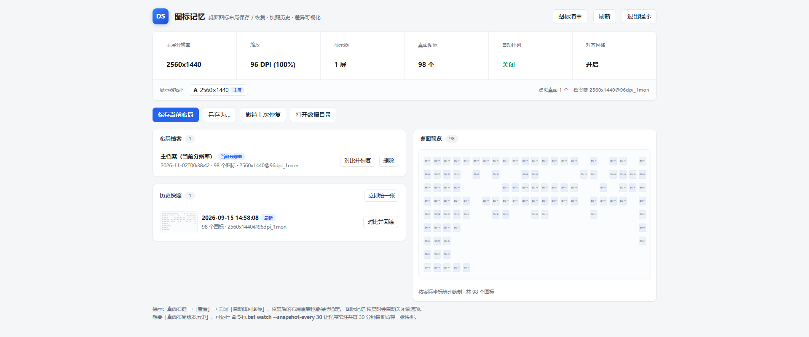

# IconMemo · Icon Memory

[简体中文](README.md) | English

> Windows desktop icon layout save & restore tool — free, open source, single file, no third-party runtime dependencies.


After plugging in an external monitor, switching resolution, changing scaling, or accidentally
toggling "Auto arrange icons", your desktop icons often get reshuffled — and Windows offers no "undo".
IconMemo remembers where you put your icons, so you can restore them with one click at any time.



---

## Download

**No installation, no Python — download, unzip, and run.**

| File | Description |
|---|---|
| [`IconMemo_v1.0.0_win64.zip`](https://github.com/kiterworks/IconMemo/releases/download/v1.0.0/IconMemo_v1.0.0_win64.zip) | **Recommended**. GUI + CLI + docs in one package |
| [`IconMemo.exe`](https://github.com/kiterworks/IconMemo/releases/download/v1.0.0/IconMemo.exe) | GUI only (8.3 MB) |
| [`IconMemoCLI.exe`](https://github.com/kiterworks/IconMemo/releases/download/v1.0.0/IconMemoCLI.exe) | CLI only (8.2 MB) |
| [`SHA256SUMS.txt`](https://github.com/kiterworks/IconMemo/releases/download/v1.0.0/SHA256SUMS.txt) | SHA256 checksums for verifying file integrity |

Requires **Windows 10 / 11 (64-bit)**. All releases:
[Releases](https://github.com/kiterworks/IconMemo/releases).

> The binaries are not code-signed. Antivirus warnings are a common false positive for
> unsigned programs — verify the checksum in `SHA256SUMS.txt` (e.g.
> `certutil -hashfile IconMemo.exe SHA256`) and add a trust exception.

---

## The problem it solves

Windows scatters your desktop icon positions in all of these situations, and none of them can be undone:

- Plugging/unplugging external monitors, projecting, switching resolution
- Changing display scaling (DPI)
- GPU driver updates or resolution glitches
- Accidentally toggling "Auto arrange icons"

If your desktop has dozens of carefully placed icons, one reshuffle means dragging them all back by
hand. IconMemo exists for exactly this scenario.

---

## Features

| Capability | Description |
|---|---|
| **Layout profiles** | Auto-grouped by "primary resolution + DPI + monitor count"; the right profile is matched automatically when the environment changes |
| **Snapshot history** | Keeps layout history like version control, with thumbnails; roll back to any version |
| **Diff preview** | Before restoring, shows exactly which icons will move and where — in color — for you to confirm |
| **Monitor topology** | Records each display's resolution, position, and scale; compared before every restore |
| **Coordinate scaling** | If the desktop area changes by more than 2%, positions are scaled proportionally so icons stay on screen |
| **Auto-restore** | A resident watcher restores the matching profile whenever resolution/monitor changes are detected |
| **Undo** | Automatic backup before every restore; undo the last restore at any time |

### Interface

The screenshot above is the main window: environment cards and layout profiles on the left,
snapshot history at the bottom, and the current desktop drawn to scale on the right.

> Icon names in the screenshot are masked (shown as numbers) to protect user privacy.

---

## Getting started

### Option 1: download the exe (recommended, no Python needed)

Grab `IconMemo_v1.0.0_win64.zip` from
[Releases](https://github.com/kiterworks/IconMemo/releases), unzip it, then:

- Double-click `IconMemo.exe` to open the GUI
- Or use `IconMemoCLI.exe` from a terminal (see [Command line](#command-line))

### Option 2: run from source (Python 3.9+)

```bash
git clone https://github.com/kiterworks/IconMemo.git
cd IconMemo

# GUI (starts a local server bound to 127.0.0.1 and opens your default browser)
python iconmemo_gui.py

# or the command line
python iconmemo.py save            # save the current main layout
python iconmemo.py restore         # restore the main layout
```

### Option 3: build your own single-file exe

```bash
pip install pyinstaller

pyinstaller --noconfirm --onefile --noconsole --icon icon.ico --name IconMemo    iconmemo_gui.py
pyinstaller --noconfirm --onefile --console  --icon icon.ico --name IconMemoCLI iconmemo.py
```

> Tip: if you use `--specpath`, `--icon` must be an **absolute path**, otherwise the icon won't be found.

---

## Command line

```text
save                     save the current main layout
save <name>              save as a named layout
restore                  restore the main layout
restore --dry-run        show which icons would move, without moving them
undo                     undo the last restore

snapshot "note"          take a snapshot right now
snapshots                list snapshot history (with change counts)
rollback 2               roll back to the 2nd newest snapshot

topology                 show monitor topology details
list                     list all layout profiles
info                     print current desktop icons and coordinates
doctor                   environment self-check (troubleshooting)

watch                    resident watcher: auto-restore on resolution/monitor changes
autostart                enable auto-watch at login (no admin rights needed)
autostart --off          disable auto-watch at login
```

---

## Where data lives

```text
%LOCALAPPDATA%\IconMemo\
├── Layouts\      layout profiles (*.json, UTF-8 — human-readable, editable, portable)
├── Snapshots\    snapshot history (last 60 kept by default)
└── Backups\      automatic pre-restore backups (last 30 kept, used for undo)
```

- Everything is **plain text** — inspect it, edit it, copy it to another machine
- **No registry writes, no system traces** (unless you explicitly run `autostart`)
- Deleting the whole `IconMemo` folder uninstalls it completely

---

## How it works

Pure Python standard library + `ctypes` calling Win32 API directly — **no third-party
runtime dependencies at all**.

The call chain that locates the desktop icon container:

```text
FindWindow("Progman")
  → SHELLDLL_DefView
    → SysListView32
```

Cross-process ListView access is done with `OpenProcess` + `VirtualAllocEx` +
`WriteProcessMemory` / `ReadProcessMemory`, together with `LVM_GETITEMPOSITION` /
`LVM_SETITEMPOSITION` / `LVM_GETITEMTEXT`.

> Before restoring, `LVS_EX_AUTOARRANGE` (0x100) must be cleared, otherwise
> `LVM_SETITEMPOSITION` is ignored by the system; `LVS_EX_SNAPTOGRID` (0x80000)
> can be safely restored afterwards.

---

## Known limitations

- Requires `explorer.exe` to be running (true in any normal desktop session).
- If "Auto arrange icons" is enabled, the program turns it off before restoring — that's a
  Windows limitation (positions can't be kept while it's on), not a program bug.
- Desktop icons can **only live on the primary monitor** (a hard Windows limitation).
  For multiple scenarios (work / gaming / presentation), save one named layout per scenario
  and switch with one click.
- Antivirus warnings are a common false positive for unsigned packaged binaries — add a trust
  exception.

---

## FAQ

**Q: Icons got scrambled again after a restore?**
Check right-click on desktop → "View" → "Auto arrange icons". While it's checked, Windows
forces a re-sort.

**Q: Can I take my layouts to another computer?**
Yes. Copy the `.json` files from `%LOCALAPPDATA%\IconMemo\Layouts\` to the same path on the
new machine.

**Q: Does it use the network?**
No. It runs entirely offline and stores all data locally.

**Q: exe version vs. source version?**
Identical features, built from the same code. The exe needs no Python and runs out of the box;
the source needs Python 3.9+ but lets you read and modify the implementation.

**Q: Antivirus flags the exe?**
The binaries aren't code-signed, so this is a common false positive. Verify the checksum from
[SHA256SUMS.txt](https://github.com/kiterworks/IconMemo/releases)
(`certutil -hashfile IconMemo.exe SHA256`), then add a trust exception.

**Q: Does it touch my files?**
It only reads desktop icon names and coordinates. Importing layout files from other tools is
read-only as well — nothing is modified, moved, or deleted.

---

## Support the project

This is a hobby project, free and open source. If it saved you from re-arranging icons,
feel free to buy me a coffee via the QR code below — entirely voluntary, and nothing is
locked behind it.

<p align="center">
  
</p>

<p align="center"><sub>Thanks to everyone who uses it and sends feedback — that matters more than donations.</sub></p>

---

## License

[MIT](LICENSE) © 2026 Kiter

## Note

This project was designed based on publicly available user needs, feature scopes described in
public channels for similar tools, and Microsoft's official Win32 API documentation. All code
was written independently.

The program supports **read-only import** of existing `.dsv` layout files. The file or folder
must be specified explicitly by the user; the program only reads files under that path and
never modifies, moves, or deletes anything.
