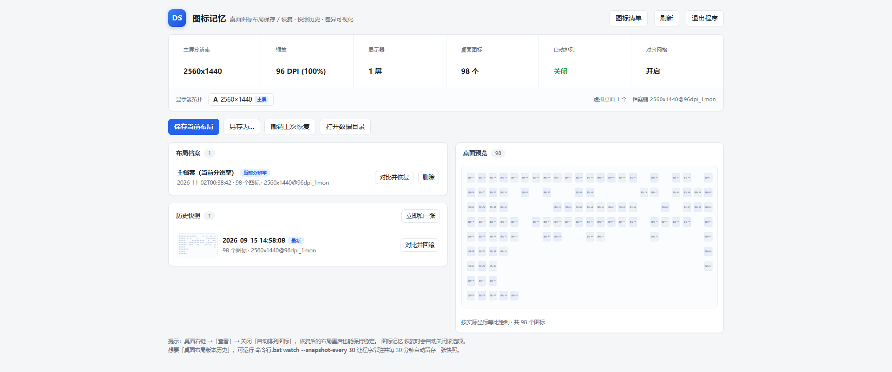

# IconMemo · 图标记忆

> Windows 桌面图标布局保存 / 恢复工具 —— 免费开源，单文件，不依赖第三方运行库。

插拔外接显示器、切换分辨率、调整缩放比例、误触「自动排列图标」之后，
桌面图标往往会重新排布，而 Windows 并不提供「撤销」。
IconMemo 把你排好的图标位置存下来，之后随时一键还原。



---

## 它解决什么问题

Windows 桌面图标的位置会在这几种情况下被打乱，而且系统没有提供还原入口：

- 插拔外接显示器、投屏、切换分辨率
- 更改缩放比例（DPI）
- 显卡驱动更新、分辨率异常后恢复
- 误触「自动排列图标」

排了几十个图标的桌面，重排一次就得手动挪回去。IconMemo 就是为这个场景做的。

---

## 功能

| 能力 | 说明 |
|---|---|
| **布局档案** | 按「主屏分辨率 + DPI + 显示器数」自动分档，换环境后自动匹配对应档案 |
| **历史快照** | 像版本控制一样留存布局历史，带缩略图，可回滚到任意一版 |
| **差异可视化** | 恢复前用颜色标出哪些图标会移动、移到哪，确认后再执行 |
| **显示器拓扑** | 记录每块屏的分辨率、位置、缩放；恢复前比对差异 |
| **坐标自适应** | 桌面区域变化超过 2% 时按比例缩放，避免图标跑到屏幕外 |
| **自动恢复** | 常驻监视，检测到分辨率/显示器变化时自动恢复对应档案 |
| **撤销** | 每次恢复前自动备份，可撤销上一次恢复 |

### 界面

上面那张就是主界面：左侧是环境卡片与布局档案，下方是历史快照，右侧按实际坐标等比绘制当前桌面。

> 截图中的图标名称已做脱敏处理（显示为编号），以保护使用者隐私。

---

## 快速开始

### 方式一：直接用（需要 Python 3.9+）

```bash
git clone https://github.com/<your-name>/IconMemo.git
cd IconMemo

# 图形界面（会启动一个仅监听 127.0.0.1 的本地服务，并用默认浏览器打开）
python iconmemo_gui.py

# 或者命令行
python iconmemo.py save            # 保存当前主布局
python iconmemo.py restore         # 恢复主布局
```

### 方式二：自己打包成单文件 exe

```bash
pip install pyinstaller

pyinstaller --noconfirm --onefile --noconsole --icon icon.ico --name IconMemo    iconmemo_gui.py
pyinstaller --noconfirm --onefile --console  --icon icon.ico --name IconMemoCLI iconmemo.py
```

> 提示：若使用 `--specpath`，`--icon` 必须传**绝对路径**，否则会报找不到图标。

---

## 命令行

```text
save                     保存当前主布局
save <名称>              另存为带名字的布局
restore                  恢复主布局
restore --dry-run        只显示会移动哪些图标，不实际移动
undo                     撤销上一次恢复

snapshot "备注"          立即拍一张快照
snapshots                列出快照历史（含变化量）
rollback 2               回滚到第 2 新的一张

topology                 显示显示器拓扑详情
list                     列出全部布局档案
info                     打印当前桌面图标及坐标
doctor                   环境自检（排障用）

watch                    常驻监视：分辨率/显示器变化时自动恢复
autostart                设置开机自动监视（免管理员）
autostart --off          取消开机自动监视
```

---

## 数据存放

```text
%LOCALAPPDATA%\IconMemo\
├── Layouts\      布局档案（*.json，UTF-8，可直接阅读 / 编辑 / 拷到别的机器）
├── Snapshots\    历史快照（默认保留 60 张）
└── Backups\      恢复前自动备份（保留最近 30 份，可撤销）
```

- 全部为**普通文本文件**，可直接查看和迁移
- **不写注册表、不留系统痕迹**（除非主动执行 `autostart`）
- 删除整个 `IconMemo` 目录即完成卸载

---

## 技术实现

纯 Python 标准库 + `ctypes` 直接调用 Win32 API，**不依赖任何第三方运行库**。

定位桌面图标容器的调用链：

```text
FindWindow("Progman")
  → SHELLDLL_DefView
    → SysListView32
```

跨进程读写在 ListView 上完成：`OpenProcess` + `VirtualAllocEx` +
`WriteProcessMemory` / `ReadProcessMemory`，配合 `LVM_GETITEMPOSITION` /
`LVM_SETITEMPOSITION` / `LVM_GETITEMTEXT`。

> 恢复前必须清除 `LVS_EX_AUTOARRANGE`(0x100)，否则 `LVM_SETITEMPOSITION`
> 会被系统忽略；`LVS_EX_SNAPTOGRID`(0x80000) 恢复后可以安全还原。

---

## 已知限制

- 需要 `explorer.exe` 正在运行（正常桌面环境都满足）。
- 若「自动排列图标」处于开启状态，恢复前程序会自动关闭它 —— 这是 Windows 的限制
  （不关掉就无法保持位置），不是程序本身的问题。
- 桌面图标**只能存在于主屏**，无法放到副屏（Windows 的客观限制）。
  多场景（工作 / 游戏 / 演示）建议各存一套命名布局，一键切换。
- 若杀毒软件提示风险，是未签名打包程序的常见误报，添加信任即可。

---

## 常见问题

**Q：恢复后图标又乱了？**
检查桌面右键 →「查看」→「自动排列图标」是否处于勾选状态。勾选时 Windows 会强制重排。

**Q：换了电脑，布局能带走吗？**
可以。把 `%LOCALAPPDATA%\IconMemo\Layouts\` 下的 `.json` 拷到新机器同一位置即可。

**Q：会联网吗？**
不会。程序运行时不需要网络连接，所有数据保存在本地。

**Q：会改我的文件吗？**
只读取桌面图标的名称与坐标。导入其它工具的布局档案时也是只读，不会修改、移动或删除既有文件。

---

## 赞助

这个项目是业余时间做的，免费开源。如果它帮你省了重新排列图标的时间，
可以扫下面的码请我喝杯咖啡 —— 完全自愿，不影响任何功能。

<p align="center">
  
</p>

<p align="center"><sub>感谢每一位使用和反馈的人，这比赞助更重要。</sub></p>

---

## 许可

[MIT](LICENSE) © 2026 Kiter

## 声明

本项目的设计依据为公开的用户需求、同类工具在公开渠道描述的功能范围，
以及 Microsoft 官方 Win32 API 文档。全部代码为自主编写。

程序支持**只读导入**已有的 `.dsv` 布局档案文件。导入时需由用户显式指定文件或目录，
程序只读取该路径下的文件，不修改、移动或删除任何既有文件。
